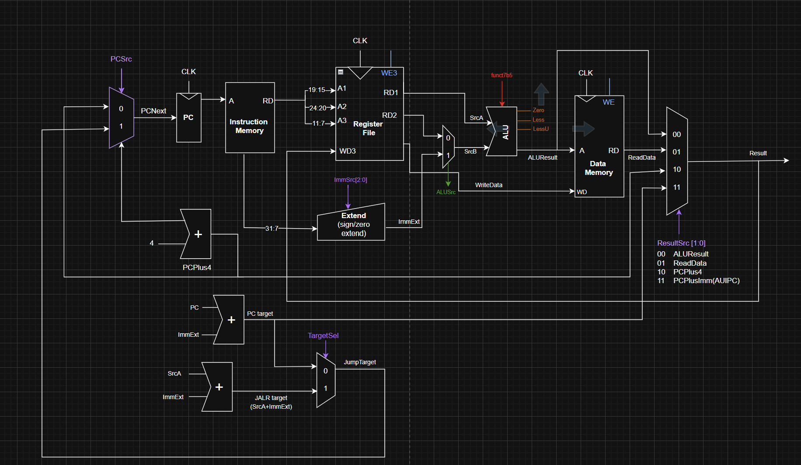
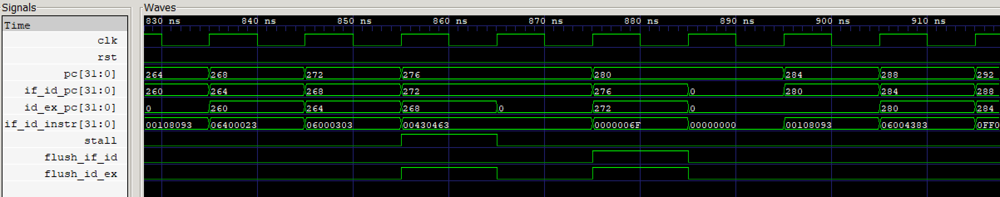
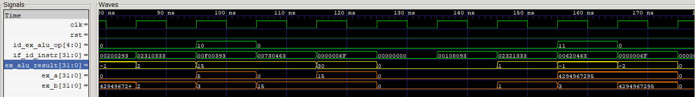

# RISC-V Processor in Verilog: Single-Cycle, 5-Stage Pipeline and RV32M

A 32-bit RISC-V processor written in Verilog and developed in three stages:

1. **Single-cycle RV32I core**, extending the Harris & Harris datapath to the full base integer instruction set
2. **5-stage pipelined core** (IF, ID, EX, MEM, WB) with data forwarding, load-use stalls and branch flushing
3. **RV32M extension** on the pipelined core: multiply, divide and remainder

Each stage is verified with a self-checking testbench and a hand-written assembly test program.

Final project for *Digital Electronics*, Tongji University, Shanghai, 2025/26.

Full design report: [docs/report_riscv_processor.pdf](docs/report_riscv_processor.pdf)

## Results

| Design | Test program | Result |
|---|---|---|
| Single-cycle RV32I | `finaltest_base.txt`, 18 test groups | Passed (score 25 written to address 100) |
| Pipelined RV32I | same program | Passed (score 25/25) |
| Pipelined RV32M | `finaltest_mul.txt`, 8 tests | Passed (score 8/8) |

On the same test program the single-cycle core executes 78 instructions in 78 cycles, while the pipelined core reaches the final store at cycle 127. The difference comes from the hazard penalties: every test group ends with a taken branch, and each taken branch or jump costs two flushed cycles. On a branch-heavy test like this one, the benefit of pipelining is the shorter clock period, not a lower cycle count.

## Supported instructions

| Type | Instructions |
|---|---|
| R-type | ADD, SUB, SLL, SLT, SLTU, XOR, SRL, SRA, OR, AND |
| I-type ALU | ADDI, SLTI, SLTIU, XORI, ORI, ANDI, SLLI, SRLI, SRAI |
| Loads | LB, LH, LW, LBU, LHU |
| Stores | SB, SH, SW |
| Branches | BEQ, BNE, BLT, BGE, BLTU, BGEU |
| Upper immediate | LUI, AUIPC |
| Jumps | JAL, JALR |
| RV32M (pipeline only) | MUL, MULH, MULHSU, MULHU, DIV, DIVU, REM, REMU |

FENCE, PAUSE, ECALL and EBREAK are not implemented.

## Single-cycle datapath



The datapath (drawn in draw.io, source in `docs/images/datapath_single_cycle.drawio.svg`) extends the Harris & Harris single-cycle design. Purple signals are the control signals added for full RV32I support:

- **Extend** handles all five immediate formats (I, S, B, J, U) through a 3-bit `ImmSrc`
- **ALU flags** `Zero`, `Less` (signed, `sum[31] ^ overflow`) and `LessU` (unsigned) let the controller evaluate all six branch conditions
- **Two target adders**: `PC + ImmExt` for branches and JAL, `rs1 + ImmExt` for JALR, selected by `TargetSel`
- **4-way result mux**: ALU result, load data, PC+4 (link for JAL/JALR) or PC+Imm (AUIPC)
- **Data memory** with byte and halfword access and sign or zero extension on loads

## Pipelined core

The pipelined core (`rtl/riscv_pipeline.v`) has four pipeline registers (IF/ID, ID/EX, EX/MEM, MEM/WB) and the following hazard handling:

| Hazard | Solution |
|---|---|
| Data dependency (ALU result needed by the next instructions) | Forwarding unit with EX/MEM → EX and MEM/WB → EX paths; the more recent EX/MEM value has priority |
| Load-use (loaded value needed by the next instruction) | Hazard detection unit freezes PC and IF/ID for one cycle and inserts a bubble in ID/EX |
| Taken branch or jump | Resolved in EX with predict-not-taken; IF/ID and ID/EX are flushed (2-cycle penalty) |

A dedicated `branch_unit` evaluates the six branch conditions on the forwarded operands in EX, and stores generate byte-enable masks (`wstrb`) for SB and SH.

The waveform below (GTKWave) shows both mechanisms. `LB x6, 96(x0)` is followed by `BEQ x6, x4`, so `stall` holds the PC for one cycle. When the BEQ reaches EX the branch is taken, and `flush_if_id` / `flush_id_ex` discard the instructions fetched after it:



## RV32M extension

All eight RV32M instructions are R-type with `funct7 = 0000001`, so they follow the existing pipeline path and need no changes to forwarding or hazard detection. The changes are limited to:

- **control unit**: `alu_op` widened from 4 to 5 bits, with new codes 10 to 17 decoded from `funct3`
- **ALU**: 64-bit products with explicit signed/unsigned operand extension for MUL, MULH, MULHSU and MULHU; division and remainder return the values required by the RISC-V specification on division by zero

In the model below the ALU computes these operations combinationally in one cycle. `MUL` gives 5 × 3 = 15 (`alu_op = 10`) and `MULH` gives the upper word of (−1) × 3, which is −1 (`alu_op = 11`):



## Verification

The test program (`programs/finaltest_base.s`) is split into test groups, each targeting a set of instructions. Every group increments a pass counter in `ra` and ends with a branch that skips an infinite-loop trap only if the result is correct. A wrong result traps the processor, so the final value written to memory is only correct if every group has passed.

| Group | Instructions | Group | Instructions |
|---|---|---|---|
| G01 | LUI, AUIPC | G10 | BNE |
| G02 | ADD | G11 | BLT, BGE |
| G03 | SUB | G12 | BLTU, BGEU |
| G04 | AND, OR, XOR | G13 | SB, LB |
| G05 | SLT, SLTU | G14 | LBU |
| G06 | SLL, SRL | G15 | SH, LH |
| G07 | SRAI, SRA | G16 | LHU |
| G08 | ORI, ANDI, XORI | G17 | SW, LW |
| G09 | SLTI, SLTIU | G18 | JAL, JALR |

Simulation output of the pipelined core:

```
 RV32I Pipeline Processor - Simulation Results
 Cycles elapsed   : 139
 Score in mem[100]: 25
 STATUS : ALL TESTS PASSED [score=25/25]
```

(The testbench keeps running for 15 cycles after the program reaches its final loop, so that the last store can commit. The program itself completes its final store at cycle 127.)

## Running the simulations

Requires [Icarus Verilog](https://steveicarus.github.io/iverilog/).

```bash
make single     # single-cycle core
make pipeline   # pipelined core, RV32I program
make rv32m      # pipelined core, RV32M program
make all        # all three
```

Each run writes a `.vcd` file in `programs/` that can be opened in GTKWave.

## Repository structure

```
rtl/        riscv_single_cycle.v, riscv_pipeline.v (RV32I + RV32M)
sim/        self-checking testbenches
programs/   assembly source and machine-code test programs ($readmemh format)
docs/       design report (PDF), datapath diagram and simulation waveforms
Makefile    simulation targets
```

## Possible extensions

Synthesis on an FPGA for timing and resource figures, exception and interrupt support, a multi-cycle divider instead of the combinational one, and dynamic branch prediction to reduce the taken-branch penalty.

## Reference

D. M. Harris and S. L. Harris, *Digital Design and Computer Architecture: RISC-V Edition*, Morgan Kaufmann, 2021.

## Author

Camilla Malossi, Automation Engineering, University of Bologna (AlmaTong double degree programme with Tongji University)
